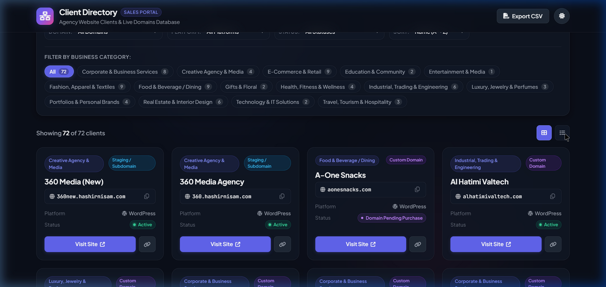

# Agency Client Directory & Domain Portal

An interactive, high-performance web dashboard built for agency sales and business development teams to explore, search, filter, and directly access all active client websites and their business categories.

---

## 🔗 Live Link

* **Deployed URL**: *(Deployment in progress / Host on GitHub Pages / Vercel / Netlify)*
* **Local Preview**: `http://localhost:8085`

---

## 📸 Preview



---

## 📖 Project Description

The **Agency Client Directory & Domain Portal** was created to empower agency sales representatives and business development executives with an immediate, searchable inventory of all agency client websites.

Instead of navigating through cloud hosting control panels (Hostinger hPanel) or maintaining static spreadsheets, the sales team can:
- Instantly verify what website clients exist across 15 distinct business industries.
- Access live custom domains directly with a single click.
- Filter between custom live domains and staging subdomains.
- Copy domain names and URLs with one click for CRM entry or email proposals.
- Export filtered client lists to CSV for cold calling and sales outreach campaigns.

---

## 🛠️ Tech Stack

- **Semantic HTML5**: Modern semantics (`<header>`, `<main>`, `<section>`, `<article>`, `<footer>`) for maximum accessibility and SEO readiness.
- **Modern Vanilla CSS**: Custom design system using CSS custom properties (variables), obsidian/dark slate glassmorphism, responsive grid & flexbox layouts, micro-interactions, and GPU-accelerated transforms.
- **Modern JavaScript (ES6+)**: Modular architecture, reactive filtering, multi-criteria search, live KPI calculation, clipboard API integration, and client-side CSV generation.
- **Typography & Icons**: Google Fonts (*Plus Jakarta Sans* & *JetBrains Mono*) and Font Awesome 6.

---

## ✨ Features

- 🔍 **Instant Omnibox Search**: Instant client-side search across client names, domain names, categories, platform types, and keywords with `/` keyboard shortcut support.
- 🏷️ **15 Industry Category Filter Chips**: One-click pills with dynamic client counters for fast browsing (e-commerce, food & beverage, real estate, corporate, fashion, health, tech, and more).
- 🌐 **Domain Type & Platform Filtering**: Easily toggle between production custom domains (`.com`, `.ae`, etc.) and staging subdomains (`*.hashirnisam.com`), as well as WordPress vs custom HTML applications.
- 📊 **Real-time Sales KPI Stat Bar**: Live statistics showing Total Clients (91) across 15 distinct Industry Categories.
- 🔀 **Dual View Modes**:
  - **Listing / Table View (Default)**: Clean, high-density spreadsheet-style table optimized for rapid data scanning, direct domain visits, and copying.
  - **Card Grid View**: Visual card presentation with category badges and direct visit actions.
- 📋 **One-Click Clipboard Tools**: Copy domain or complete website URL with animated toast feedback.
- 📥 **One-Click CSV Export**: Download the filtered or full client roster directly into CSV format for CRM imports.
- ☀️ **Clean Minimalist Theme**: Clean light/white theme layout for readability and fast scanning during sales meetings.

---

## 🚀 Local Setup / Run Instructions

1. **Clone or navigate to the repository directory**:
   ```bash
   cd WB-Clients-List
   ```

2. **Start a local development server** (using any static HTTP server):
   ```bash
   # Option 1: Python 3
   python -m http.server 8085

   # Option 2: Node npx serve
   npx serve .
   ```

3. **Open the application**:
   Open your browser and navigate to:
   ```
   http://localhost:8085
   ```
